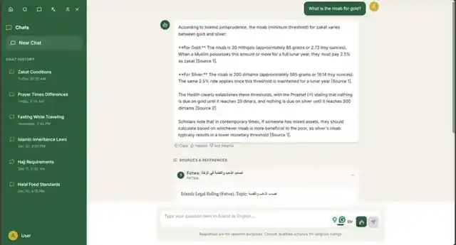
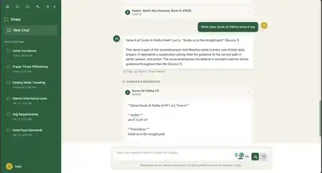
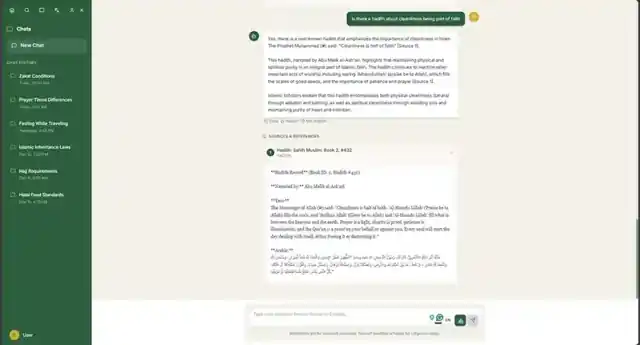
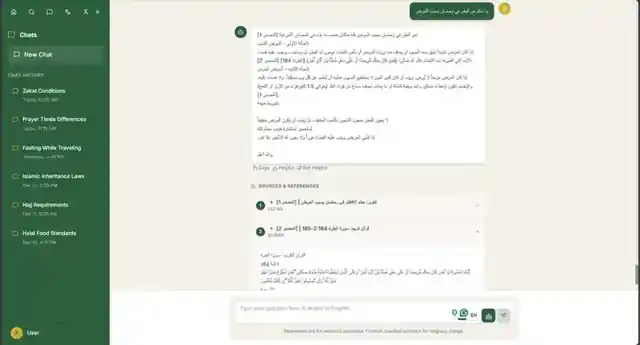

# Islamic Studies Scholarly Platform

[](https://github.com/Oussam-beep/Islamic-Studies-Scholarly-Platform/actions/workflows/tests.yml)


A bilingual (Arabic/English) Retrieval-Augmented Generation (RAG) prototype for exploring Qur'an, hadith, fiqh, and fatwa passages. It retrieves source text, conditions a local language model on that evidence, and returns source records alongside the generated answer.

> **Research use only.** This prototype is not a religious authority and does not replace qualified scholars. The presence of a citation does not guarantee that a claim is supported by the cited passage.

## Application screenshots

The screenshots show the companion web interface used during development. The React frontend itself is maintained separately; this repository contains the Python retrieval pipeline and API.

| English answer with sources | Qur'an source expanded |
|---|---|
|  |  |

| Hadith source expanded | Arabic answer with Qur'an source |
|---|---|
|  |  |

[View all screenshots in the repository](https://github.com/Oussam-beep/Islamic-Studies-Scholarly-Platform/tree/main/docs/screenshots)

## How it works

**Indexing:** local corpus files → normalized passages with provenance → multilingual embeddings → Qdrant vector store.

**Question answering:** Arabic or English question → keyword-based source routing → filtered vector search → prompt with numbered source passages → local LLM generation → citation-tag existence check → answer plus retrieved source records.

- **Passage provenance:** references and metadata are retained for source inspection.
- **Arabic and English:** the default embedding model is `BAAI/bge-m3`; the default generation model is `Qwen/Qwen2.5-7B-Instruct`.
- **Source-aware retrieval:** keyword routing applies source-type filters and detects direct Qur'an verse references; a failed filtered search can fall back to unfiltered retrieval.
- **Citations:** the pipeline checks whether source numbers in the answer correspond to retrieved passages. This checks citation existence only, not whether a passage entails each claim.
- **Interfaces:** command-line chat and a FastAPI service exposing `/ask`, `/health`, and `/warmup`.

## Tech stack

| Area | Technology |
|---|---|
| API | Python 3.10+, FastAPI, Uvicorn |
| Vector search | Qdrant |
| Embeddings | Sentence Transformers, `BAAI/bge-m3` |
| Generation | Hugging Face Transformers, `Qwen/Qwen2.5-7B-Instruct` |
| Corpus processing | JSON, `ijson` |
| Testing | pytest, HTTPX |

## Quick start

### 1. Install

```bash
git clone https://github.com/Oussam-beep/Islamic-Studies-Scholarly-Platform.git
cd Islamic-Studies-Scholarly-Platform
python -m venv .venv
```

Activate the environment:

```bash
# macOS / Linux
source .venv/bin/activate

# Windows PowerShell
.venv\Scripts\Activate.ps1
```

Install the project and development dependencies:

```bash
pip install -e ".[ml,dev]"
```

A compatible GPU is recommended for the 7B generation model. First-time model downloads can be large; install a PyTorch build appropriate for your machine.

### 2. Add the corpus

Corpus files are deliberately not included in Git. Follow [data/README.md](data/README.md) to place source files under `data/raw/`, and verify the terms of each dataset before using or redistributing it.

### 3. Build an index

Start Qdrant locally for a small trial:

```bash
docker run --name islamic-rag-qdrant -p 6333:6333 -v qdrant_storage:/qdrant/storage qdrant/qdrant
```

Set `QDRANT_URL=http://localhost:6333` in your environment, then run:

```bash
python -m islamic_rag.corpus --data-dir data/raw --limit 20
python -m islamic_rag.build_index --limit 200 --recreate
```

**Warning:** `--recreate` deletes and rebuilds the selected Qdrant collection. Use it only when you intend to replace the index.

### 4. Ask questions

Run the CLI:

```bash
python -m islamic_rag.chat
```

Or start the API:

```bash
uvicorn islamic_rag.api:app --host 127.0.0.1 --port 8000
```

Open [http://127.0.0.1:8000/docs](http://127.0.0.1:8000/docs) to inspect the API. Example request:

```bash
curl -X POST http://127.0.0.1:8000/ask \
  -H "Content-Type: application/json" \
  -d '{"question":"What does verse 2:255 say?","top_k":5}'
```

## Repository layout

```text
src/islamic_rag/       Corpus loader, retrieval, generation, CLI and API
tests/                 Unit tests and API contract tests
notebooks/             Prototype notebook with saved outputs
data/README.md         Local corpus layout and data handling
docs/screenshots/      Application screenshots
docs/                  Data model, ID conventions and project notes
```

## Tests

Run the automated tests with:

```bash
pytest
```

The suite uses test doubles for selected model and vector-store paths; it does not measure religious correctness or answer quality on a curated evaluation benchmark. A live run requires the local corpus, a vector store, and downloaded model weights.

## Known limitations

- The keyword router can over-filter or miss a topic.
- Retrieved passages can be related but incorrect or incomplete; the prototype does not yet include a reranker or hybrid search.
- Citation checking confirms that a cited source number exists in the retrieved set, not that the cited text supports the claim.
- There is no formal retrieval/answer-quality evaluation benchmark yet.
- Hadith numbering follows the supplied corpus record IDs and may differ from published edition numbering.
- Translation, word-sense disambiguation, speech-to-text, human-review workflows, and a deployed frontend are roadmap items, not features to assume are implemented here.


---
Built as an AI/NLP research prototype with a focus on provenance and evidence inspection.
